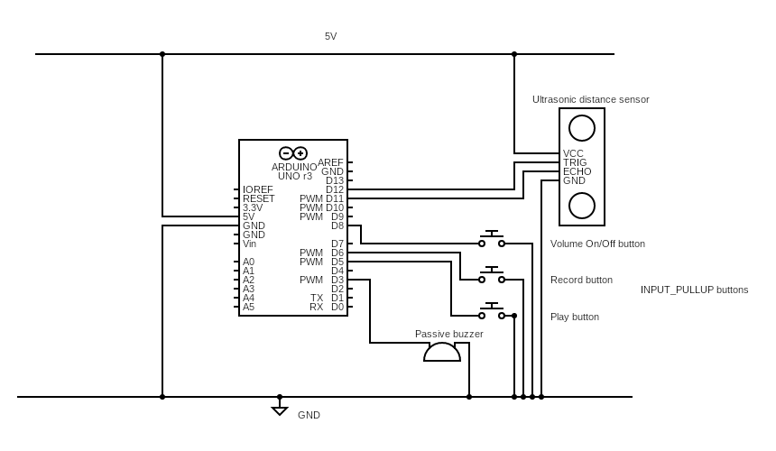

## Theremin Arduino
A theremin made with an ultrasonic sensor and an Arduino. Includes a record and playback feature.

### Hardware:
- HC-SR04 Ultrasonic distance sensor
- 3 INPUT_PULLUP Push Buttons
- Piezo Passive Buzzer

### Dependencies:
- pitches.h file with all notes.
- SR04 library which can be downloaded in the Arduino library.

### How it works:
- The distance recorded from the sensor is mapped to a musical frequency. The closer the user is to the sensor, the higher the theremin pitch. The musical notes are mapped from NOTE_C5 (near) to NOTE_F1 (far).
The difference between C4 and C5 is the octave.

### States:
- Theremin State
Pressing the volume button turns off/on the theremin sounds. Pressing Record or Play switches the states.
- Record State
When Record is pressed, it records the notes for 10 seconds or when 100 notes have been reached, whichever metric is true first. Once done, it goes back to the Theremin state. Any new song recorded is recorded over.
- Play State
When play is pressed, it plays the notes recorded during the record state. Once done, it goes back to the Theremin state. 

### Where are the notes stored?
The notes are stored in a structure data type which stores the notes as (frequency, duration) in an array. The recording capacity is 100 notes which is fixed. There is no dynamic resizing.

### How does the INPUT_PULLUP button work?
When the button is not pressed, the button is connected to an internal pull up resistor and 5V so it reads as HIGH. When the button is pressed, it connects the pin directly to GND, so it reads LOW.

### How does the Passive Buzzer work?
Unlike the active buzzer, the passive buzzer does not have an internal oscillator. It just has a piezo electric material. It clicks every time it flexes, and it flexes when voltage is applied to it. To get a musical note, you have to create the oscillation. Arduino does this for you with the tone() function, which uses a hardware timer to flip the pin on and off at whatever frequency you give it. pitches.h is used just to name these frequencies (like NOTE_C5) instead of writing raw numbers.
